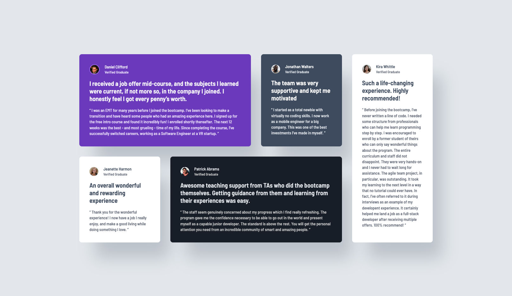

# Frontend Mentor - Testimonials grid section solution

This is a solution to the [Testimonials grid section challenge on Frontend Mentor](https://www.frontendmentor.io/challenges/testimonials-grid-section-Nnw6J7Un7). Frontend Mentor challenges help you
improve your coding skills by building realistic projects.

## Table of contents

- [Overview](#overview)
    - [The challenge](#the-challenge)
    - [Screenshot](#screenshot)
    - [Links](#links)
- [My process](#my-process)
    - [Built with](#built-with)
    - [What I learned](#what-i-learned)
    - [Continued development](#continued-development)
    - [Author](#author)

## Overview

### The challenge

Users should be able to:

- View the optimal layout for the site depending on their device's screen size

### Screenshot

### Links

- Solution URL: https://github.com/KingRocko/Testimonials-grid-section
- Live Site URL: https://kingrocko.github.io/Testimonials-grid-section/

## My process

### Built with

- Semantic HTML5 markup
- CSS custom properties
- Flexbox
- CSS Grid
- Mobile-first workflow

### What I learned

My main takeaways from this challenge:

- **Custom Properties:** Once again, I realized how much work can be saved by carefully planning and structuring CSS custom properties right from the beginning. Separating primitive from semantic
  properties takes some effort initially, but once everything is in place, writing the actual CSS classes becomes a relatively small task.

- **CSS Grid and minmax():** Another good exercise in using `grid-template-columns` with `minmax(0, 1fr)` to create equally sized columns that can shrink properly. Combined with `grid-template-areas`,
  this makes it quite easy to rearrange the layout across different screen sizes.

- **CSS Cascade Layers:** I'm getting more comfortable organizing my CSS into separate layers for resets, base styles, layout, and components. It helps me keep things structured and makes the cascade
  more predictable.

- **Mobile-First Approach:** Starting with a simple single-column layout and progressively adding complexity through media queries worked well. The main challenge was figuring out the right
  breakpoints and making sure the different card arrangements worked nicely at intermediate screen sizes.

Overall, this challenge reminded me that spending more time on the initial CSS architecture actually saves quite a bit of time later on.

### Continued development

I'd like to continue improving my CSS Grid and Flexbox skills, especially when it comes to creating responsive layouts that behave well at different screen sizes.

I also want to get more confident with choosing breakpoints based on the actual content rather than specific device sizes.

Another area I'd like to focus on is refining my approach to CSS custom properties, making them even more consistent, reusable, and easier to maintain across larger projects.

### Author

Author: King Rocko